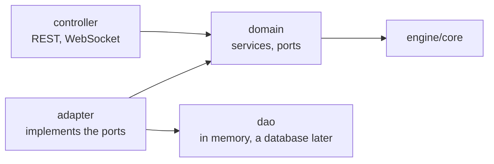

# Shardbound

An invented 1v1 card game, built as a testbed for AI engineering: a rules Arbiter (RAG and LoRA), an MCP coach agent, AI opponents and a rigorous evaluation bench. No language model can know the rules of an invented game, so every correct answer must come from retrieval or fine-tuning, and the engine computes the ground truth to grade them. Full plan: [`docs/design.md`](docs/design.md).

## Run it

```bash
docker compose up --build
```

Then open http://localhost:4200 and play against a bot (`random`, or `greedy` for a real opponent), or create a game against a human and send the invite link.

Without Docker (Java 21, Node 24):

```bash
cd engine && ./mvnw -pl api -am spring-boot:run   # game server, http://localhost:8080
cd frontend && npm install && npm start           # client, http://localhost:4200
```

Tests: `cd engine && ./mvnw verify`, `cd frontend && npm test`. Bot reports, on demand: `cd engine && ./mvnw -pl core test -Preports`.

To host it on Google Cloud Run: [`engine/README.md`](engine/README.md), then [`frontend/README.md`](frontend/README.md).

## Repository

| Path | What |
|---|---|
| `docs/` | Design document and rulebook ([`docs/rules/`](docs/rules/README.md)) |
| `content/` | Cards and decks as JSON, with their schemas and tests |
| `engine/core` | The rules engine: Java 21, no framework ([entry points and scenario service](engine/core/README.md)) |
| `engine/api` | The game server: Spring Boot, REST and WebSocket |
| `engine/dataset`, `engine/corpus` | The Arbiter's evaluation questions with their answer keys, and its RAG chunks |
| `ai/` | The AI layer: Python, the dataset's wording and the RAG ([`ai/README.md`](ai/README.md)) |
| `evals/` | The evaluation datasets and every saved evaluation |
| `frontend/` | The client: Angular, with the game and the benchmark lab |
| `AGENTS.md`, `.claude/` | What coding agents read: instructions, skills, hooks, review agents |

## Backend architecture

**`engine/core` is a pure library.** Immutable game states; `apply(state, action)` returns the new state and the events that led to it, each with the IDs of the rules applied. Players, human or bot, answer with the index of one of the legal actions the engine lists.

**`engine/api` is the game server**, in layers that only call downwards (checked by an ArchUnit test):



The domain knows neither persistence nor transport. No server instance keeps a game in memory: every move is saved with an optimistic lock, and a small notification tells the other instances that the game moved, so it can run on several instances. For now the games are saved in memory, so it runs as one instance until a shared database replaces it.

## Built with coding agents

Most of the code is written by coding agents, mostly Claude Code, and I make the decisions. Agents read `AGENTS.md` and the project's skills. Hooks, review agents and CI catch their mistakes: a command on the test split is refused, failing tests send the agent back, and a pull request that lowers retrieval recall is blocked. How it works, with real examples: [`docs/dev-workflow.md`](docs/dev-workflow.md).

## Status

Phase 2 is done: the rules, 47 cards and three decks, an engine that plays every rule, effect and keyword, two bots that never see hidden cards, the game server and the client.

Phase 3, the RAG Arbiter, is in progress. Its evaluation dataset has 668 questions, and the engine writes every answer key. Its retrieval (BM25 and embeddings fused by RRF, the cards' cross-references, a cross-encoder reranker) puts 71.1% of the rules and cards a question must cite in its top 10, on the dev questions (October 2026). Generating the answers and grading them come next. Details: the Status of [`AGENTS.md`](AGENTS.md), and the [roadmap](docs/design.md).
