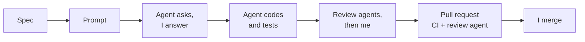

# How Shardbound is built with coding agents

I build Shardbound with coding agents, mostly Claude Code. I make the decisions. The agent writes most of the code, the tests and the docs. Tests, hooks and CI catch its mistakes. This page shows how it works.

## The loop



1. A spec in `specs/` says what to build, piece by piece.
2. Each work session starts from a prompt file (example below).
3. The agent asks its open questions, numbered, each with a recommendation. I answer.
4. The agent writes the code and its tests. When it stops, a hook runs the fast tests.
5. Review agents read the change. Then I read it.
6. One branch and one pull request per piece of work. CI checks it, a review agent comments on it, and I merge it.

## What the agent reads

| File | What it holds |
|---|---|
| [`AGENTS.md`](../AGENTS.md) | The rules for every agent: language, commands, commit format, what I decide, where the project stands. `CLAUDE.md` imports it. |
| [`.claude/skills/`](../.claude/skills/) | Nine skills, one per topic: the rules, the cards, the engine, the game server, the RAG… An agent loads the one its task needs. |
| [`specs/`](../specs/) | What to build, slice by slice. |
| [`docs/decisions/`](decisions/) | Why things are built this way, and what was rejected. |

## A prompt

Each work session starts from a prompt file. The prompts stay on my machine, but they are part of the workflow: they turn a long design talk into a short brief. This is the outline of the prompt for the engine's bots:

```
# Prompt: phase 2, slice 5 — determinization, the greedy bot and the scenario service
## 1. Read first, in this order                     the instructions, four skills, the spec's sections
## 2. Already decided: do not reopen                the scope, the design, what is not in this slice
## 3. Questions the maintainer already answered     eleven numbered answers
## 4. Where things stand                            the branch, the code that exists, what helps
## 5. How to work                                   decisions, language, code style, tests
```

Section 2 matters most. Writing down what is already decided stops the agent from asking again, or from deciding for me. Anything else, the prompt says, goes back to me: "ask the maintainer, all at once, numbered, each with your recommendation."

## Who decides what

| I decide | The agent does |
|---|---|
| The game rules | Writes the code, the tests and the docs |
| The design and the architecture | Proposes options, with a recommendation |
| What is measured, and how | Marks a gap it fills as *(proposed)* |
| Every merge | Keeps the docs in sync with the code |

## Guardrails

I don't count on the agent remembering a rule. When a rule matters, a test, a hook or CI checks it.

| Mistake | What catches it |
|---|---|
| A rule with no test | `RulebookCoverageTest` fails |
| Code in the wrong layer of the server | An ArchUnit test fails |
| A new keyword the RAG does not know | The code does not compile: its switches have no default |
| A dataset question citing a chunk that does not exist | `DatasetCitationsTest` fails |
| Python and Java disagree on a legal deck | Both test suites read the same cases |
| A command on the test split | A hook refuses it |
| An agent stops with failing tests | A hook runs them and sends it back |
| A review agent tries to change a file | A hook lets only reading commands through |
| A doc points to a file that moved | `scripts/check-doc-paths.py`, in CI |
| A bad commit message | A git hook, and CI |
| A change lowers retrieval recall | The RAG gate compares the baseline with main's evaluation |
| A change to retrieval comes without its evaluation | The RAG gate refuses the pull request |

## Three mistakes, and what caught them

**A silent hole in the answer keys.** A card with two Echo attacks asks its owner which one goes first. A dataset scenario never answered that question, so it stopped there, and its answer key missed both echoes. Nothing failed. Now a scenario must play to the end, or the build names the question it stopped on (commit `78e883c`).

**A letter that broke a lookup.** To find the cards a question names, the first draft ignored case. A review agent found a trap: with case ignored, a question that writes "ſ" (an old form of "s") matches a card name, but the matched words then find no card. Names are now matched on the lowercased question (commit `293fe02`).

**Docs that drifted.** The project status was written in three files. After the reranker was merged, all three still said it was next. The status now lives in one place, and a new CI check found five more broken paths in the agents' docs on its first run.

## Steering, not only checking

For the reranker, three designs were refused before any code: a retriever computed again for each reranker, a cache inside the retriever, and a ranking handed back to the retriever. The code has the fourth: a tree of steps, where each node is computed once. The reasons are in [`docs/decisions/rag.md`](decisions/rag.md).

## In numbers (October 2026)

- 193 of the 196 commits on `main`, merges aside, were written with Claude Code. Each ends with a `Co-Authored-By` line.
- 17 pull requests, one per piece of work.

## Try it

- Open the repository in Claude Code: `AGENTS.md`, the skills, the hooks and the review agents load by themselves.
- Turn on the commit check once: `git config core.hooksPath .githooks`.
